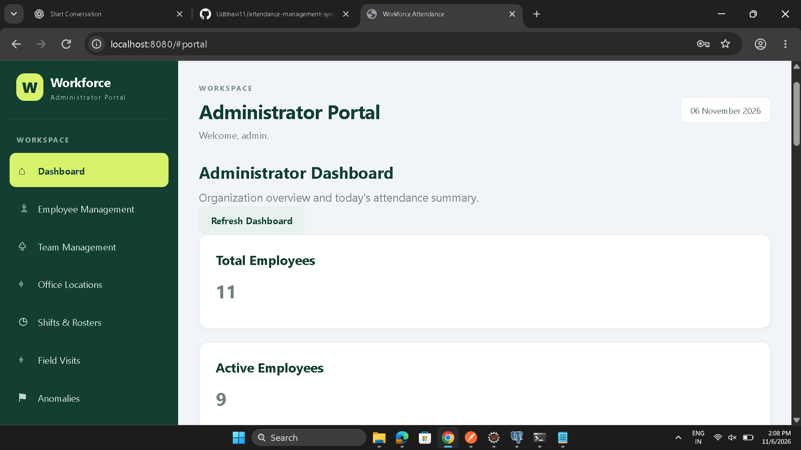
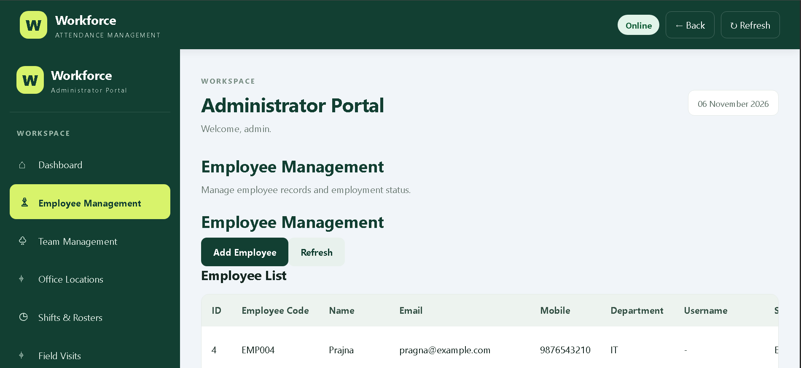
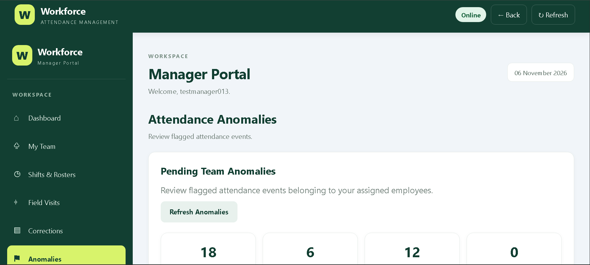
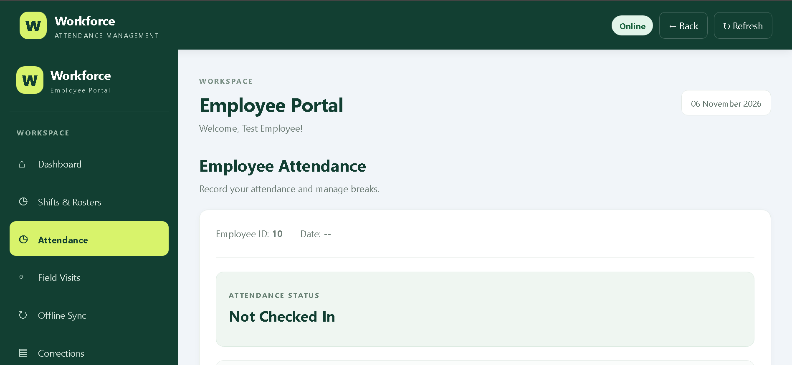
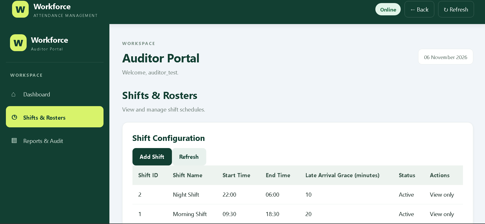
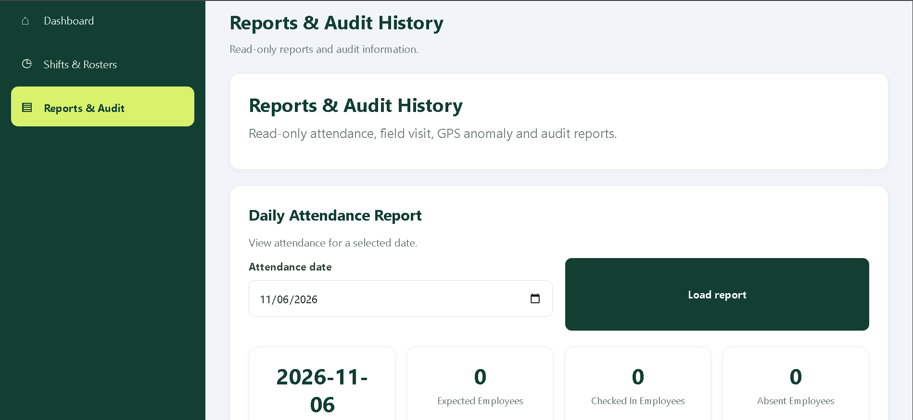

# Workforce Attendance Management System

A **mobile browser-based attendance and field workforce management system** built using Java, Spring Boot, PostgreSQL, and JavaScript.

The application helps organizations manage employees, track attendance, configure shifts and office locations, monitor field visits, and review attendance anomalies through a centralized platform.

## Project Overview

The Workforce Attendance Management System provides role-based functionality for administrators, managers, employees, and auditors.

It supports attendance tracking, office geofencing, field visit monitoring, attendance corrections, offline attendance synchronization, and reporting through a browser-based interface.

## Key Features

### 1. Employee Management
- Create, view, and update employee records.
- Activate and deactivate employees.
- Assign employees to teams, managers, shifts, and office locations.
- Manage employee login accounts and roles.

### 2. Team Management
- Create and manage teams.
- Assign employees to teams.
- View team membership.

### 3. Office Location Management
- Configure office locations using latitude and longitude.
- Set permitted attendance radius using geofencing.
- Manage office location records.

### 4. Attendance Management
- Employee check-in and check-out.
- Location-based attendance validation.
- Break tracking.
- Attendance record management.

### 5. Shift and Roster Management
- Create and manage shifts.
- Activate and deactivate shifts.
- Assign employee rosters.
- Support bulk roster creation.

### 6. Field Visit Management
- Start and complete field visits.
- View field visit records.
- Track employee field visits.
- Support field visit corrections.

### 7. Anomaly Management
- Retrieve attendance anomalies.
- View pending anomalies for manager review.
- Review and update anomaly status.

### 8. Attendance Corrections
- Submit attendance correction requests.
- View correction requests.
- Allow managers to approve or reject requests.

### 9. Offline Attendance
- Submit offline attendance data for synchronization.

### 10. Reports and Audit History
- Attendance reports.
- Field visit reports.
- GPS anomaly reports.
- Audit record history.

## User Roles

The application supports four roles:

| Role | Responsibility |
|---|---|
| ADMIN | Employee, team, office, and organizational management |
| MANAGER | Team oversight, anomaly review, and correction approvals |
| EMPLOYEE | Attendance, breaks, and field visit operations |
| AUDITOR | Attendance and audit record review |

Access to application operations is controlled through role-based authorization.

## Screenshots

### Administrator Dashboard



### Employee Management



### Manager Dashboard – Anomalies



### Employee Attendance



### Shifts and Rosters



### Reports and Audit History



## Technology Stack

| Layer | Technologies |
|---|---|
| Backend | Java, Spring Boot |
| REST APIs | Spring Web |
| Security | Spring Security |
| Persistence | Spring Data JPA, Hibernate |
| Database | PostgreSQL |
| Database Migration | Flyway |
| Frontend | HTML, CSS, JavaScript |
| Build Tool | Maven |
| API Testing | Postman |
| IDE | Eclipse / VS Code |

## Application Architecture

The application follows a layered architecture:

```text
Browser-based Frontend
        |
        | HTTP / REST API
        v
Spring Boot Controllers
        |
        v
Service Layer
        |
        v
Repository Layer
        |
        v
PostgreSQL Database
```

- **Controller Layer:** Handles HTTP requests and responses.
- **Service Layer:** Contains business logic and validations.
- **Repository Layer:** Handles database operations using Spring Data JPA.
- **Database Layer:** Stores employee, attendance, shift, roster, and related records.

## Database Management

The application uses PostgreSQL for persistent storage and Flyway for version-controlled database migrations.

Current migration structure:

```text
src/main/resources/
└── db/
    └── migration/
        └── V1__initial_schema.sql
```

Flyway manages database schema migrations, while Hibernate schema validation helps verify that the database structure matches the application entities.

Future database changes should be introduced through new versioned migration files rather than modifying migrations that have already been applied.

## Getting Started

### Prerequisites

Install the following:

- Java Development Kit (JDK)
- Maven
- PostgreSQL
- Git
- IDE such as Eclipse or IntelliJ IDEA

### 1. Clone the Repository

```bash
git clone https://github.com/Udbhavi11/attendance-management-system.git
```

### 2. Navigate to the Project

```bash
cd attendance-management-system
```

### 3. Create the PostgreSQL Database

Create a database named `attendance_db`:

```sql
CREATE DATABASE attendance_db;
```

### 4. Configure Environment Variables

Configure the following environment variables before starting the application:

| Variable | Description |
|---|---|
| DB_URL | PostgreSQL JDBC connection URL |
| DB_USERNAME | PostgreSQL username |
| DB_PASSWORD | PostgreSQL password |

Example configuration for a local database:

```text
DB_URL=jdbc:postgresql://localhost:5432/attendance_db
DB_USERNAME=postgres
DB_PASSWORD=your_database_password
```

Use your own database credentials. Never commit passwords, API keys, or other sensitive information to GitHub.

### 5. Run the Application

Start the application using Maven:

```bash
mvn spring-boot:run
```

Alternatively, build the application:

```bash
mvn clean package
```

Then run the generated JAR from the `target` directory.

### 6. Access the Application

Once the application starts, open:

```text
http://localhost:8080
```

## API Documentation

The backend exposes REST APIs for the application's major modules, including:

- Authentication and authorization
- Employee management
- Team management
- Office location management
- Attendance management
- Shift and roster management
- Field visit management
- Anomaly management
- Attendance corrections
- Offline attendance
- Reports and audit history

Refer to the corresponding controller classes in the source code for API endpoints, request methods, parameters, and request bodies.

## Project Structure

```text
attendance-system/
│
├── src/
│   └── main/
│       ├── java/
│       │   └── com/workforce/attendance/
│       │       ├── controller/
│       │       ├── service/
│       │       ├── repository/
│       │       ├── entity/
│       │       ├── dto/
│       │       ├── exception/
│       │       └── config/
│       │
│       └── resources/
│           ├── static/
│           ├── db/
│           │   └── migration/
│           └── application.properties
│
├── screenshots/
├── pom.xml
├── .gitignore
└── README.md
```

## Future Enhancements

- Cloud deployment.
- Improved dashboard analytics and visualizations.
- Additional notification capabilities.
- Further mobile usability improvements.

## Author

**Udbhavi N M**

GitHub: [Udbhavi11](https://github.com/Udbhavi11)

**Project:** Workforce Attendance Management System
